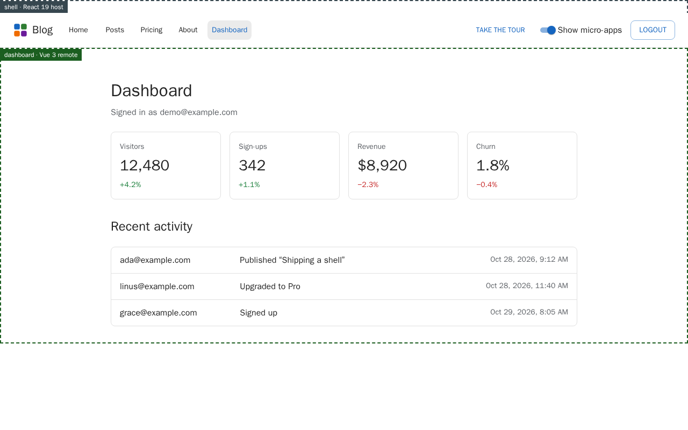
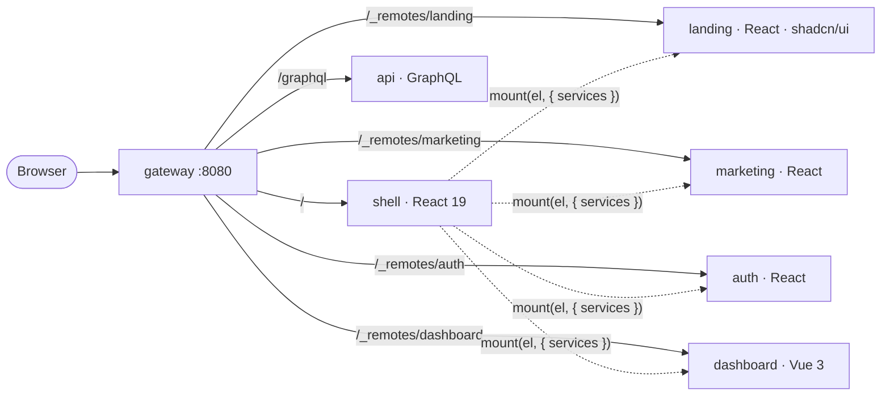
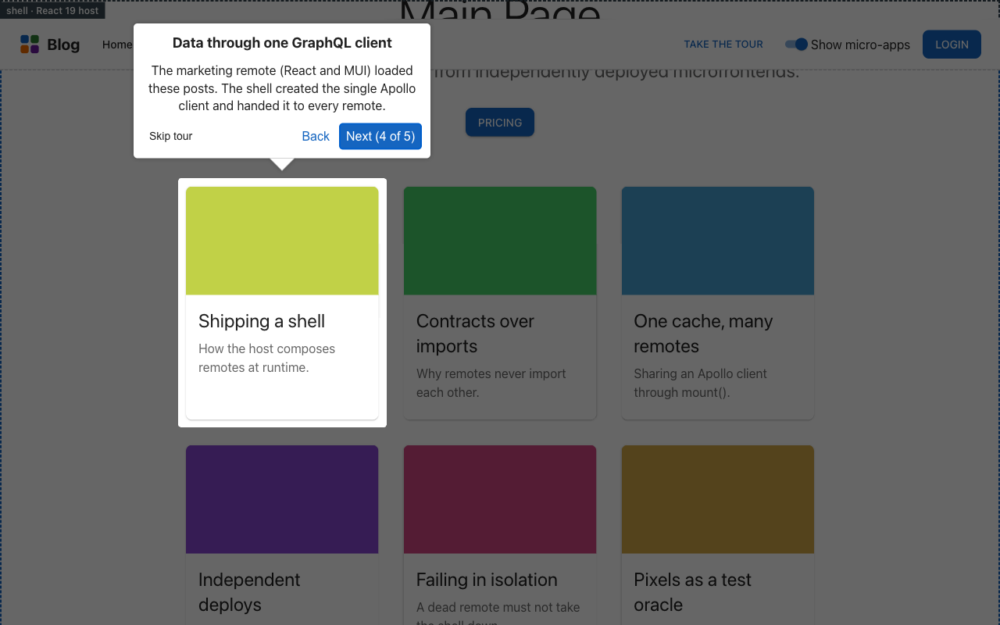

# Microfrontends, done carefully

[](https://github.com/nikolai-tatianenko/microfrontends-examples/actions/workflows/ci.yml)

A blog assembled **at runtime in the browser** from independently built and deployed pieces: a React shell,
three React remotes (one styled with **shadcn/ui + Tailwind v4**, the rest with MUI), a **Vue 3** remote, a GraphQL API and
a shared design system, all behind one origin. The apps are built with **Rspack** and the landing remote with **Vite**.

The point is not that it can be done, but **how it fails and how you know it still works**: contained errors,
a typed host/remote contract, four test layers, visual regression, and a CI pipeline that reports its results
in the pull request.

<p align="center">
  
</p>

## What to look at first

| If you care about…    | Start here                                                                                                                                                   |
| --------------------- | ------------------------------------------------------------------------------------------------------------------------------------------------------------ |
| The integration idea  | [`packages/contract`](packages/contract/src) (one function) and [ADR 0001](docs/adr/0001-host-injects-services.md)                                           |
| Failure handling      | [`apps/shell/src/remotes`](apps/shell/src/remotes), [ADR 0002](docs/adr/0002-runtime-load-remote.md)                                                         |
| Deployment            | [`infra/`](infra), [ADR 0003](docs/adr/0003-same-origin-remote-prefix.md)                                                                                    |
| GraphQL               | [`apps/api/src/modules`](apps/api/src/modules), [ADR 0004](docs/adr/0004-graphql-modular.md)                                                                 |
| Tests                 | [`docs/architecture.md#7`](docs/architecture.md#7-test-strategy), [ADR 0005](docs/adr/0005-testing-strategy.md), [measured test review](docs/test-review.md) |
| CI and PR reporting   | [`docs/ci.md`](docs/ci.md)                                                                                                                                   |
| The honest trade-offs | [Do you need microfrontends?](docs/why-microfrontends.md) and [ADR 0007](docs/adr/0007-when-not-to-use-microfrontends.md)                                    |

Full diagrams (system, runtime sequence, contract, GraphQL, design system, tests): **[docs/architecture.md](docs/architecture.md)**.



## Do you need microfrontends?

Probably not. They solve an **organisational** problem: several teams that must release independently. Technically they
cost you build-time safety, duplicate dependencies and more things to deploy and observe. The
[full guide](docs/why-microfrontends.md) has the benefits and costs side by side, a decision flowchart and a rule of thumb.

<p align="center">
  
</p>

## Use cases

Where the ideas in this repo pay off, roughly from strongest fit to weakest:

| Use case                                       | Why it fits                                                                                                                                | What this repo shows                                                                      | What it does not show                                                                                                                                                           |
| ---------------------------------------------- | ------------------------------------------------------------------------------------------------------------------------------------------ | ----------------------------------------------------------------------------------------- | ------------------------------------------------------------------------------------------------------------------------------------------------------------------------------- |
| **Gradual modernisation of a legacy frontend** | A shell in front of the old app lets you move one route at a time to a new stack while the product keeps shipping (the strangler pattern). | A framework-agnostic `mount()` contract; React, Vue and Vite-built remotes side by side.  | Wrapping a real legacy app (its router, global styles, session) as a remote.                                                                                                    |
| **Many teams, independent releases**           | Teams that block each other's releases get their own build, deploy and ownership boundary.                                                 | One image per app, a gateway, modular CI, an overlay that names the owner of each region. | Org-level concerns: a platform team, on-call and versioning policy.                                                                                                             |
| **Internal superapp or portal**                | Modules from different departments appear under one login, one navigation and one design language.                                         | A host-injected session and Apollo client, a shared design system, one origin.            | A module registry, per-module permissions and rollback.                                                                                                                         |
| **Plugin or marketplace platform**             | Third parties ship modules into your shell.                                                                                                | The contract and failure isolation are the right foundation.                              | A trust boundary: same-origin remotes can read the shell's storage ([ADR 0003](docs/adr/0003-same-origin-remote-prefix.md)). Untrusted code needs iframes or a separate origin. |
| **Merged products**                            | After an acquisition, several frontends need one entry point before they can be rewritten.                                                 | Remotes built with different frameworks and bundlers behind one shell.                    | Single sign-on across separate backends.                                                                                                                                        |

The ideas also pay off **without** splitting the deployment, in any large frontend monorepo: a typed contract between
modules, an error boundary around every major region, end-to-end tests on the built bundles, one design system and one
data client, and ADRs that record the trade-offs.

**When not to use it:** one team, one product, or boundaries that keep moving. A modular monolith is cheaper and
safer. See [Do you need microfrontends?](docs/why-microfrontends.md) for the decision flowchart.

## Run it

Requires Node 22 and [pnpm](https://pnpm.io) (`corepack enable` picks the pinned version).

```bash
pnpm install
pnpm codegen          # typed GraphQL documents (generated, not committed)
pnpm dev              # api + shell + 4 remotes, then open http://localhost:8080
```

Sign in with **`demo@example.com` / `password123`** (the sign-in form offers it with one click), or sign up with any
new email. Every region of the page is outlined and named after the app that renders it (`shell`, `landing`, `marketing`,
`auth`, `dashboard`); the "Show micro-apps" switch in the header hides the labels. A first visit opens a five-step
guided tour across three micro-apps ([ADR 0011](docs/adr/0011-guided-tour-in-the-shell.md)); "Take the tour" replays it.

Production-shaped, every app its own image behind nginx:

```bash
docker compose -f infra/docker-compose.yml up --build   # http://localhost:8080
```

## Repo map

```text
apps/
  shell/        React 19 host: top menu, routing, auth guard, remote loading, error isolation, guided tour
  landing/      React remote on shadcn/ui + Tailwind v4, built with Vite: the home page at / (static)
  marketing/    React remote: blog (/blog), pricing, about (GraphQL)
  auth/         React remote: sign in / sign up (GraphQL mutations)
  dashboard/    Vue 3 remote: stats + activity (same contract, different framework)
  api/          GraphQL API, one module per domain
packages/
  contract/     the mount() contract + session store (framework-agnostic)
  ui/           design system: atoms → templates, theme (light/dark), i18n, Storybook
  apollo/       Apollo client factory + SchemaLink test helper
  build-config/ one Rspack + Module Federation factory, one Jest preset
examples/vanilla/   the smallest possible federation setup, no framework
e2e/                Playwright: functional tests + visual regression
infra/              Dockerfile (one for all apps), nginx configs, compose
scripts/ci/         PR report generator and PR-body updater (zero-dependency Node)
docs/               architecture (Mermaid), ADRs, CI guide
```

## Commands

| Command                                              | What it does                                                        |
| ---------------------------------------------------- | ------------------------------------------------------------------- |
| `pnpm dev`                                           | all dev servers (HMR); remotes also run standalone                  |
| `pnpm test` / `pnpm test:integration`                | unit / integration tests, JUnit + coverage to `reports/`            |
| `pnpm build && pnpm e2e`                             | production build, then Playwright against it                        |
| `pnpm visual` · `pnpm visual:update`                 | visual regression · regenerate baselines **in the Linux container** |
| `pnpm storybook`                                     | design system, 34 stories (light/dark toolbar, a11y panel)          |
| `pnpm lint` · `pnpm typecheck` · `pnpm format:check` | static gates                                                        |
| `pnpm commit`                                        | Commitizen prompt that writes a Conventional Commit                 |

## Git hooks

`pnpm install` wires [Husky](https://typicode.github.io/husky/) (the `prepare` script), so the checks run before the code leaves your machine:

| Hook         | Runs                                                                                                    |
| ------------ | ------------------------------------------------------------------------------------------------------- |
| `pre-commit` | lint-staged (ESLint and Prettier on the staged files), then `pnpm typecheck`                            |
| `commit-msg` | commitlint: [Conventional Commits](https://www.conventionalcommits.org), English only, no tool trailers |
| `pre-push`   | `pnpm test:all` (unit and integration), `pnpm coverage:check`, `pnpm build`, `pnpm e2e`                 |

Write messages with `pnpm commit` (Commitizen) or by hand in the same format, for example `fix(shell): retry a failed remote`.
Stop any dev server on :8080 or :4000 before pushing, because Playwright would reuse it instead of the production build.
CI repeats all of this, and also lints every commit of a pull request. `scripts/hooks.test.mjs` checks that the hooks
exist, call these gates, and that the commit rules accept and refuse what they should. `git push --no-verify` skips the
hooks locally; CI does not.

## Quality gates

Every pull request runs the same gates you can run locally, and the results are written into the PR description:

🧪 unit tests per module with coverage · 🔗 integration tests against the real GraphQL schema ·
🎭 end-to-end tests on the production build · ♿ automated accessibility scans (axe, WCAG 2.1 AA, light and dark) · 👁️ visual regression · 🐳 image builds and compose validation.

The hand-written part of the PR body is never touched; only the block between the `ci-report` markers is
replaced on each push. Details and diagrams: [docs/ci.md](docs/ci.md).

## Known limits (deliberate, and what I would do next)

- **Auth is a demo, and the route guard is cosmetic.** Passwords are scrypt-hashed but users live in memory,
  and there are no tokens: the "session" is a client-side flag in `sessionStorage`, so anyone can forge it to
  see the dashboard _screen_, and the dashboard GraphQL queries are **not** authorised server-side. There is
  also no rate limiting on `signIn`. The seam is the `auth` API module and `SessionStore`; a real identity
  provider replaces both without touching the remotes.
- **Remotes share one origin and one trust boundary.** Fine inside one organisation; third-party remotes would
  need iframes or separate origins.
- **No runtime observability yet.** Next step: report remote load failures and Web Vitals per remote.
- **The Vue component has no Jest unit test**; its logic is in tested plain TS and the component is covered by
  E2E and visual tests ([ADR 0005](docs/adr/0005-testing-strategy.md)).
- **Bundler:** Rspack builds the shell and three remotes through one config factory; the landing remote is built with Vite and loaded through the same contract ([ADR 0009](docs/adr/0009-rspack.md)).
