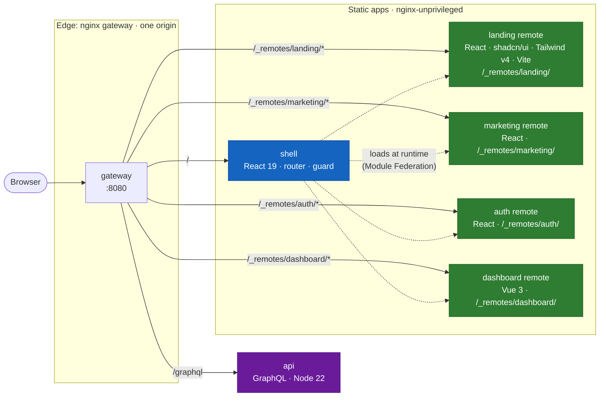
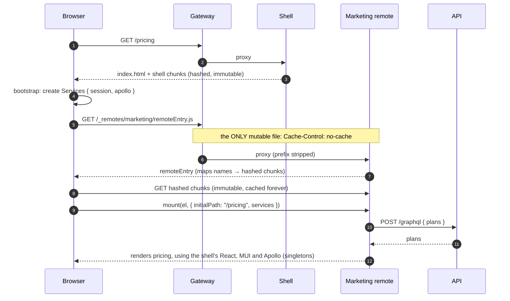
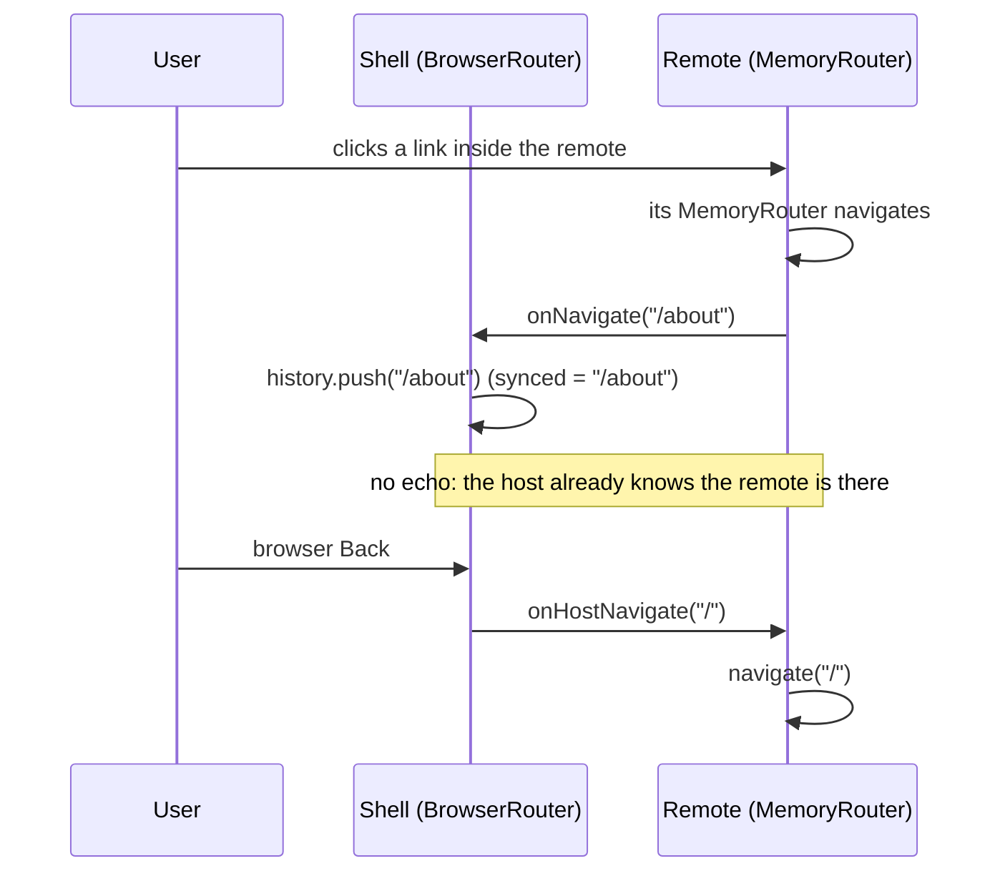
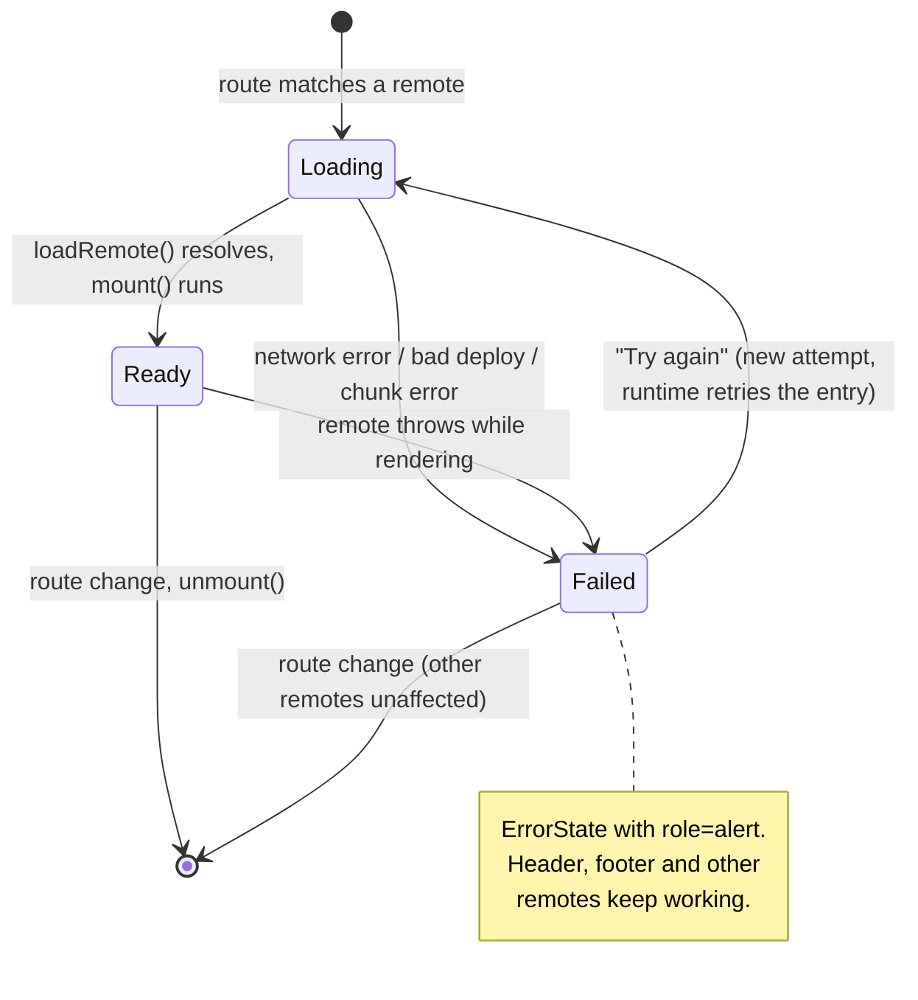
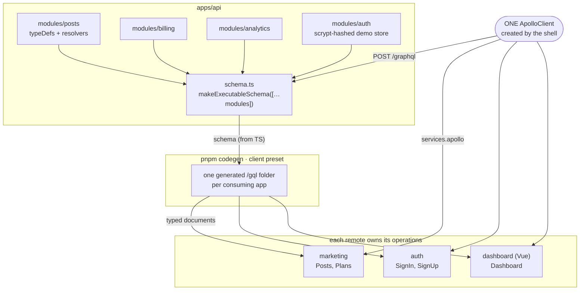
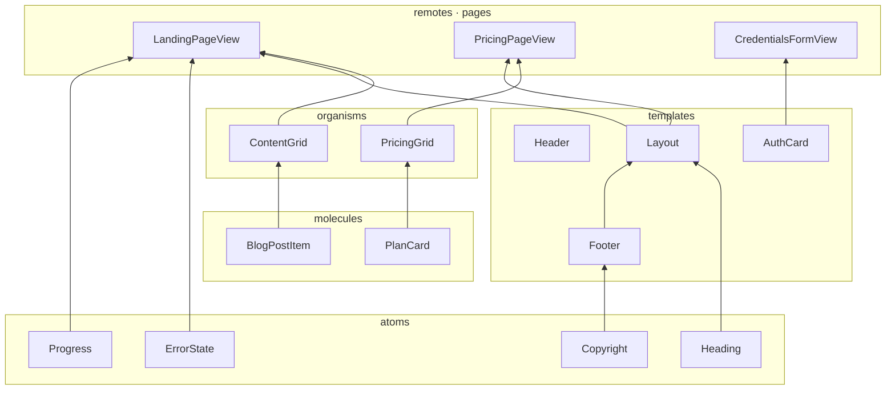
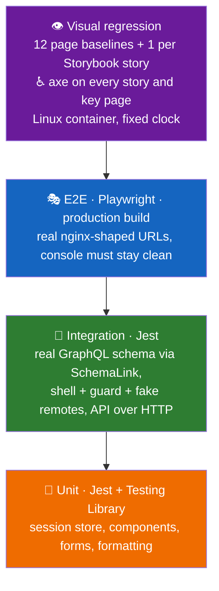

# Architecture

A blog assembled **in the browser** from independently built and deployed pieces. This page explains the
shape of the system; the _why_ behind each choice lives in [`docs/adr`](adr/README.md).

## 1. System at a glance

One public origin. Every box below is its own build, its own image, and can be redeployed on its own.



The URL space is deliberately split: **`/auth/signin` is a route the shell owns; `/_remotes/auth/…` is where the
auth remote's files live.** They never collide, which is why remotes can ship without touching the shell's routes.

## 2. Runtime composition

What happens on the first visit to `/pricing`:



## 3. The contract between host and remote

The whole integration surface is one function. React and Vue remotes implement the same type, so the shell
cannot tell them apart.

```mermaid
classDiagram
  direction LR
  class Mount {
    <<type>>
    (el: HTMLElement, options: MountOptions) MountHandle
  }
  class MountOptions {
    +string initialPath
    +Services services
    +onNavigate(path)
  }
  class MountHandle {
    +onHostNavigate(path)
    +unmount()
  }
  class Services {
    +SessionStore session
    +ApolloClient apollo
  }
  class SessionStore {
    +getUser() User|null
    +signIn(user)
    +signOut()
    +subscribe(listener)
  }

  Mount --> MountOptions : takes
  Mount --> MountHandle : returns
  MountOptions --> Services
  Services --> SessionStore

  class ReactRemote["createReactRemote(App)"] {
    root + MemoryRouter + navigation bridge
  }
  class VueRemote["dashboard/mount.ts"] {
    createApp(App, { services })
  }
  ReactRemote ..|> Mount : landing, marketing, auth
  VueRemote ..|> Mount : dashboard
```

**Capabilities flow down, events flow up.** The host _injects_ what a remote may use (session, one Apollo
client) and the remote reports navigation through a callback. Remotes never import each other and never reach
for a global store. See [ADR 0001](adr/0001-host-injects-services.md).

### Navigation stays in sync both ways



## 4. Failure isolation

A remote that is down must cost the user _one section_, not the site.



Covered at three levels: a unit test per behaviour, an integration test with a failing registry, and a Playwright
test that really aborts the remote's network requests and then recovers without a reload.

## 5. GraphQL: modular by domain, typed per consumer



- **Add a domain** by adding a folder under `apps/api/src/modules` and one line in `schema.ts`.
- **A remote only sees types for the operations it declares**; renaming a field breaks exactly the remotes that use it, at codegen time.
- **One client, one normalized cache** per page, shared through `mount()`. The Vue remote uses the same client
  (`apollo.query`), so GraphQL is not React-specific here.

## 6. Design system

`@blog/ui` is presentation only: no data fetching, no business rules. Pages in each remote have a container
(fetches) and a `*View` (renders) so every state is a Storybook story and a visual baseline.



Cross-cutting, provided once by `UiProvider`: MUI theme with **light and dark** (follows the OS), and a tiny
typed **i18n** catalog (`useT("nav.login")`). Every interactive element carries `data-test-id`.

## 7. Test strategy



| Layer       | Runs against                                                          | What it proves                                                                |
| ----------- | --------------------------------------------------------------------- | ----------------------------------------------------------------------------- |
| Unit        | one module, no network (a `fetch` that throws)                        | logic and rendering in isolation                                              |
| Integration | the **real API schema** in-process; the real shell with fake remotes  | client documents are valid against the server; the host/remote contract works |
| E2E         | the **built** apps behind a prod-shaped server (or the compose stack) | users can browse, sign in, and survive a dead remote                          |
| Visual      | pixels, in the same container image every time                        | nothing changed visually that wasn't meant to                                 |

### Bugs this pyramid caught while building it

Not hypothetical; each was found by a test, then fixed with a regression test.

| Found by              | Bug                                                                                                                                                                                           |
| --------------------- | --------------------------------------------------------------------------------------------------------------------------------------------------------------------------------------------- |
| Unit                  | `useNavigate()` changes identity on every navigation, so the remote was **unmounted and remounted on every route change**                                                                     |
| Integration           | One remote's error boundary state **leaked into the next remote's route** (React reuses the element at the same tree position)                                                                |
| Integration           | Logging out raced the router's transition and landed on the sign-in form instead of home                                                                                                      |
| E2E                   | After a remote failed, **"Try again" could never recover**: webpack caches a failed remote forever. Fixed via the Module Federation runtime API ([ADR 0002](adr/0002-runtime-load-remote.md)) |
| E2E (console fixture) | The preview proxy returned 502 for GraphQL; only the "no console errors" rule noticed                                                                                                         |
| Visual review         | A global `.who` CSS rule collided with a scoped one in the Vue dashboard                                                                                                                      |
