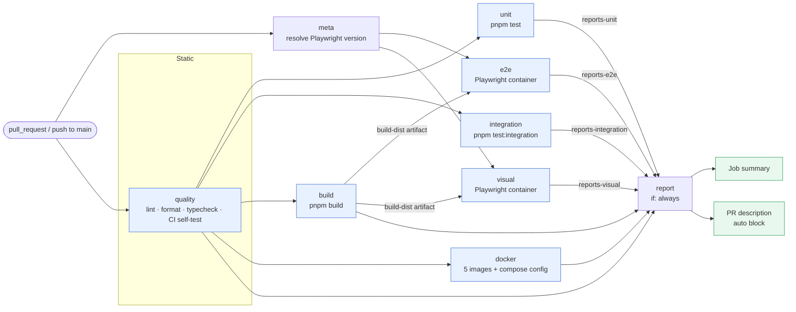
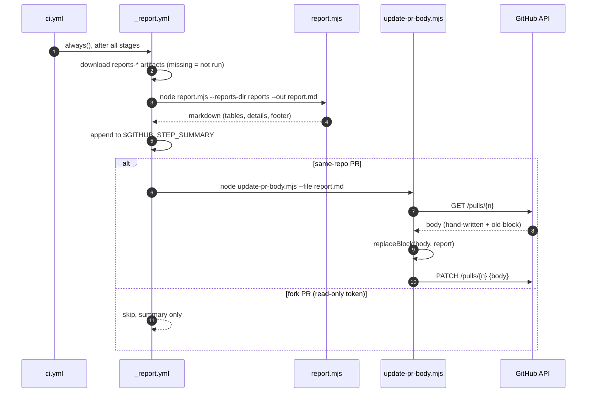
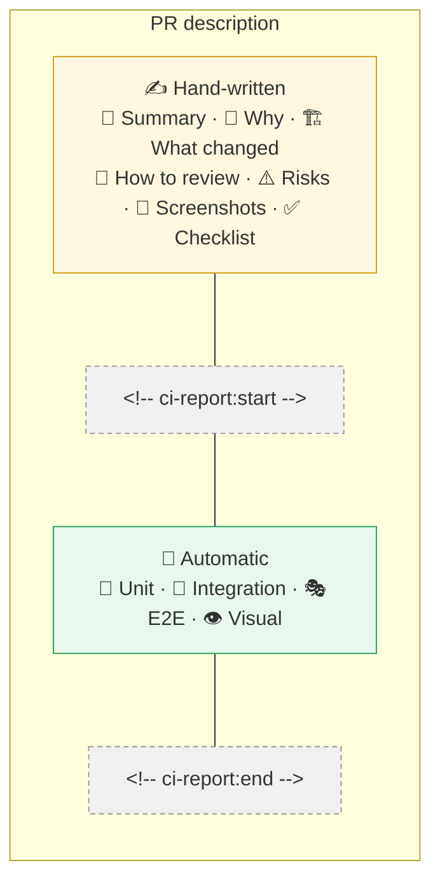

# CI/CD and PR reporting

Every pull request gets the same pipeline, and the results are written back **into the PR description** so a reviewer sees tests, e2e and visual-regression status without opening Actions.

- 🧱 **Modular**: `ci.yml` only wires things together; each concern is a reusable workflow (`_*.yml`, `workflow_call`).
- 📋 **Reporting**: one zero-dependency Node script turns JUnit / Playwright JSON into markdown tables grouped by module.
- ✍️ **Hand-written + automatic**: the author writes the description; CI owns exactly one marked block.

## Pipeline



| Workflow           | Concern                                                                  | Produces                                           |
| ------------------ | ------------------------------------------------------------------------ | -------------------------------------------------- |
| `_quality.yml`     | lint, `format:check`, typecheck, `scripts/ci` self-test                  | —                                                  |
| `_unit.yml`        | `pnpm test`                                                              | artifact `reports-unit`                            |
| `_integration.yml` | `pnpm test:integration`                                                  | artifact `reports-integration`                     |
| `_build.yml`       | `pnpm build`                                                             | artifact `build-dist`                              |
| `_e2e.yml`         | `pnpm e2e` on the production build, in the Playwright image              | artifact `reports-e2e`, traces on failure          |
| `_visual.yml`      | `pnpm visual` in the same image                                          | artifact `reports-visual` (+ raw diffs on failure) |
| `_docker.yml`      | buildx per app (`infra/Dockerfile`, `APP` build-arg), compose validation | — (no push)                                        |
| `_report.yml`      | render + publish                                                         | job summary, PR block                              |

`.github/actions/setup` is the one place that knows how to get a workspace ready: corepack → `packageManager` pnpm → Node from `.nvmrc` with the pnpm cache → `pnpm install --frozen-lockfile` → `pnpm run --if-present codegen` (GraphQL types are generated, not committed).

Design notes:

- `quality` gates everything else, so a lint error does not burn Playwright minutes.
- `report` runs with `if: always()`: a red pipeline is exactly when the table matters. A stage that never ran has no artifact, which the report shows as _not run_ rather than failing.
- e2e and visual test the **same build artifact** that `build` produced, once, instead of rebuilding.
- The Playwright image tag is read from `package.json` (`scripts/ci/playwright-version.mjs`), and the job fails fast if the installed `@playwright/test` differs, because mismatched browsers are the classic source of "works locally" screenshot noise.
- Least privilege: top-level `contents: read`; only the report job gets `pull-requests: write`.

## The report contract

Producers write, `scripts/ci/report.mjs` reads. Everything is optional.

| Stage       | File(s)                                                                          |
| ----------- | -------------------------------------------------------------------------------- |
| Unit        | `reports/unit/<module>/junit.xml`, `reports/unit/<module>/coverage-summary.json` |
| Integration | `reports/integration/<module>/junit.xml`                                         |
| E2E         | `reports/e2e/results.json` (Playwright JSON reporter)                            |
| Visual      | `reports/visual/results.json`, optional `reports/visual/diffs/*`                 |

`<module>` is the table row: `shell`, `auth`, `marketing`, `landing`, `dashboard`, `ui`, `contract`, `api`, …

The Playwright jobs set `PLAYWRIGHT_JSON_OUTPUT_FILE` to the right path, so the config only needs `reporter: [['json'], …]`. Jest packages need `jest-junit` writing to `$REPORTS_DIR/unit/<module>/junit.xml` (the workflows export `REPORTS_DIR`) and `coverageReporters: ['json-summary']`.

What the table looks like:

> ## ❌ CI report — Failing
>
> | Module     | Tests | ✅ Passed | ❌ Failed | ⏭️ Skipped | ⏱️ Time | 📈 Lines cov. |
> | ---------- | ----: | --------: | --------: | ---------: | ------: | ------------: |
> | ❌ `auth`  |     3 |         2 |         1 |          0 |   600ms |         88.0% |
> | ✅ `shell` |    12 |        12 |         0 |          0 |    2.1s |         91.2% |
> | **Total**  |    15 |        14 |         1 |          0 |    2.7s |         90.4% |

## How the PR description is updated



### The marker contract



Rules enforced by `replaceBlock(body, block)` and its tests (`scripts/ci/update-pr-body.test.mjs`):

1. Only the text from `<!-- ci-report:start -->` to `<!-- ci-report:end -->` is replaced. Everything else is preserved byte for byte.
2. No markers yet (PR opened without the template)? A block is appended; later runs update that block in place.
3. Idempotent: the same report twice gives the same body, so there is no churn or edit noise.
4. Line endings of the existing body win. GitHub stores bodies as CRLF once someone edits them in the browser.
5. A lone start marker (hand-edited by accident) is repaired, never duplicated.
6. Bodies that would exceed GitHub's 65,536-character limit are not written (warning only); the report itself is capped at ~50k characters with long lists truncated.

Write your description **above** the markers. Edits inside the markers are overwritten on the next run.

## Run each stage locally

```bash
pnpm install --frozen-lockfile && pnpm codegen   # setup
pnpm lint && pnpm format:check && pnpm typecheck # quality
pnpm test                                        # unit        -> reports/unit
pnpm test:integration                            # integration -> reports/integration
pnpm build                                       # build
pnpm e2e                                         # e2e         -> reports/e2e
pnpm visual                                      # visual      -> reports/visual
docker build -f infra/Dockerfile --build-arg APP=shell -t shell:local .
docker compose -f infra/docker-compose.yml config --quiet

# the report, exactly as the PR will show it
node scripts/ci/report.mjs --reports-dir reports            # prints markdown
node --test "scripts/ci/*.test.mjs"                         # test the CI scripts themselves
```

> The glob is needed on Node 22: `node --test <directory>` is no longer supported.

## Visual regression baselines

Screenshots only match when rendered by the same OS, fonts and browser build. Baselines are therefore **always generated on Linux in the Playwright container**, never on a Mac.

**Option 1: comment on the PR** (maintainers only, same-repo branches):

```
/update-snapshots
```

**Option 2: Actions tab**: _Update visual baselines_ → _Run workflow_ → pick the branch.

Both run `pnpm build && pnpm visual:update` in `mcr.microsoft.com/playwright:v<version>-noble`, commit the changed `*-snapshots/` files as `github-actions[bot]`, and push to the branch. Refused on forks and on `main`.

**Option 3: locally with Docker**:

```bash
docker run --rm -v "$PWD":/work -w /work --ipc=host \
  mcr.microsoft.com/playwright:v$(node scripts/ci/playwright-version.mjs)-noble \
  sh -c "corepack enable && pnpm install --frozen-lockfile && pnpm build && pnpm visual:update"
```

Then **look at the changed images in the diff** before committing. A baseline update is a design review, not a formality.

> A push made with the default `GITHUB_TOKEN` does not trigger new workflow runs. After the bot pushes baselines, push any commit (or re-run CI) to verify.

## Scripts reference

| File                                 | Purpose                                                    |
| ------------------------------------ | ---------------------------------------------------------- |
| `scripts/ci/report.mjs`              | parse reports → markdown (`--reports-dir`, `--out`)        |
| `scripts/ci/update-pr-body.mjs`      | replace the marked block in the PR body (`--file`, `--pr`) |
| `scripts/ci/playwright-version.mjs`  | resolve `@playwright/test` version for the container tag   |
| `scripts/ci/*.test.mjs`, `fixtures/` | `node:test` suites, run in the `quality` job               |
