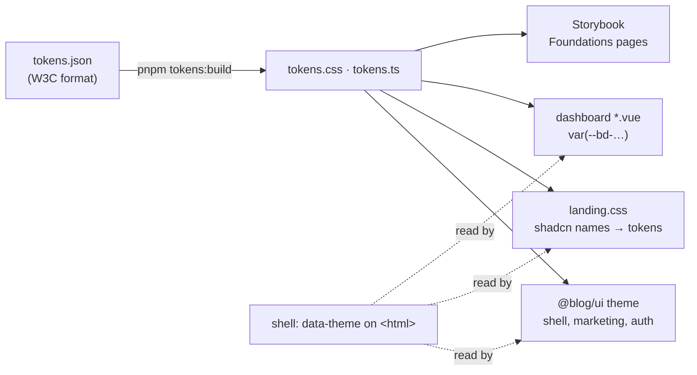

# Design system

One set of design tokens, read by three styling stacks in the same page. The decision and its trade-offs are in
[ADR 0012](adr/0012-design-tokens-as-the-shared-contract.md); this page is how to work with it.

| Piece                                    | Where                                                 |
| ---------------------------------------- | ----------------------------------------------------- |
| Tokens (source of truth)                 | `packages/tokens/tokens.json`                         |
| Generated CSS and TypeScript (committed) | `packages/tokens/src/generated/`                      |
| Color-mode runtime                       | `packages/tokens/src/mode.ts` (`@blog/tokens/mode`)   |
| Components                               | `packages/ui/src` (atoms → templates)                 |
| Documentation                            | Storybook, `Foundations/*` ([live site](#publishing)) |

## Add or change a token

1. Edit `packages/tokens/tokens.json`. Give a `$description`; give `com.blog.mode.dark` if the dark value differs and
   `com.blog.forced` (a system color) if the token paints text or a surface.
2. `pnpm tokens:build`. Commit the generated files with it.
3. If it is a color that carries text, add its pairs to `CONTRAST_PAIRS` in `packages/tokens/src/contrast.ts`.
   `pnpm --filter @blog/tokens test` then proves the ratio in both modes.
   `color.border.default` is deliberately not in the list: it is a decorative hairline (about 1.3:1 on white) that no
   control relies on to be found. A boundary that carries meaning needs its own token and a 3:1 pair (WCAG 1.4.11).
4. `pnpm changeset`: **minor** for an addition, **patch** for a value fix, **major** for a rename or removal.
5. `pnpm design:check` (also in the pre-push hook and in CI) fails when the generated files are stale or any file
   outside `packages/tokens` hard-codes a color.

Use a token from CSS as `var(--bd-color-text-muted)`; from TypeScript as `cssVar("color.text.muted")` (typed, so a
misspelling does not compile) or, where a library needs a literal, `tokens.light.color…`.

## Deprecate before you remove

Mark the token `"$deprecated": "use color.text.muted"` and publish a **minor**. The generated CSS keeps the variable,
and `pnpm tokens:lint` fails on every remaining use, listing each file and line, so consumers migrate against a
checklist. Remove it in the next **major**. There is no other way to retire a token.

## Color mode

The shell owns it; see [Theming](adr/0012-design-tokens-as-the-shared-contract.md) for why. In short:

- `<html data-theme="light|dark">` is the contract. The shell's `ThemeToggle` offers light, dark and "match system";
  the choice is stored in `localStorage` (`blog.mode`).
- CSS reads custom properties; MUI reads `useMode()`; neither keeps its own copy.
- Without a shell (a remote running alone, Storybook) the same attribute is set by the entry point or by the
  Storybook toolbar, and with none set everything falls back to the OS setting.

## Forced colors

Under `@media (forced-colors: active)` (Windows high contrast) the color tokens become system colors
(`Canvas`, `CanvasText`, `Highlight`, ...). `e2e/tests/theme.spec.ts` checks that the tokens hand over and that the
focus ring survives.

## Design tools

`tokens.json` follows the Design Tokens Community Group format, which Tokens Studio for Figma and the Figma
variables importers read. The repository does not automate a Figma sync, and no sync was tested here; the
direction that matters is code → design, and the file is built to be imported.

## What guards it

| Guard                                           | Fails when                                                                |
| ----------------------------------------------- | ------------------------------------------------------------------------- |
| `pnpm tokens:check`                             | the committed CSS or TypeScript is not what the JSON generates            |
| `packages/tokens/src/contrast.test.ts`          | any text pair drops below 7:1, or the focus ring below 3:1                |
| `pnpm tokens:lint`                              | a color literal appears outside the tokens, or a deprecated token is used |
| Storybook a11y + `e2e/visual/storybook.spec.ts` | a story fails axe (WCAG 2.2 AAA) or changes a pixel, light or dark        |
| `e2e/visual/states.spec.ts`                     | hover or focus rendering of the controls changes                          |
| `e2e/tests/theme.spec.ts`                       | one switch stops repainting any remote                                    |
| `CODEOWNERS` and changesets                     | a token change merges unreviewed or without a version note                |

## Publishing

`.github/workflows/storybook.yml` builds Storybook and deploys it to GitHub Pages on every push to `main` that touches
the design system. In the repository settings, **Pages → Source** must be set to _GitHub Actions_ once; the site then
lives at `https://nikolai-tatianenko.github.io/microfrontends-examples/`.
