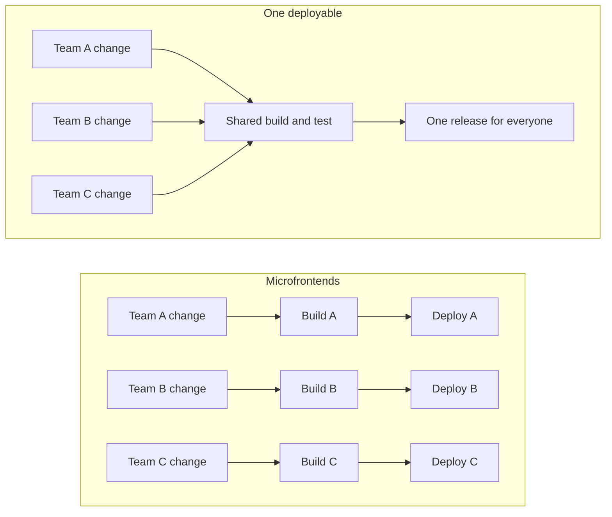
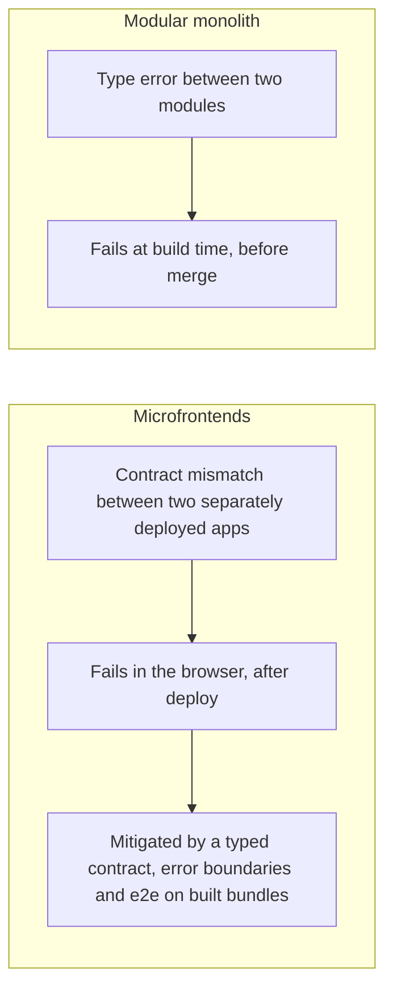
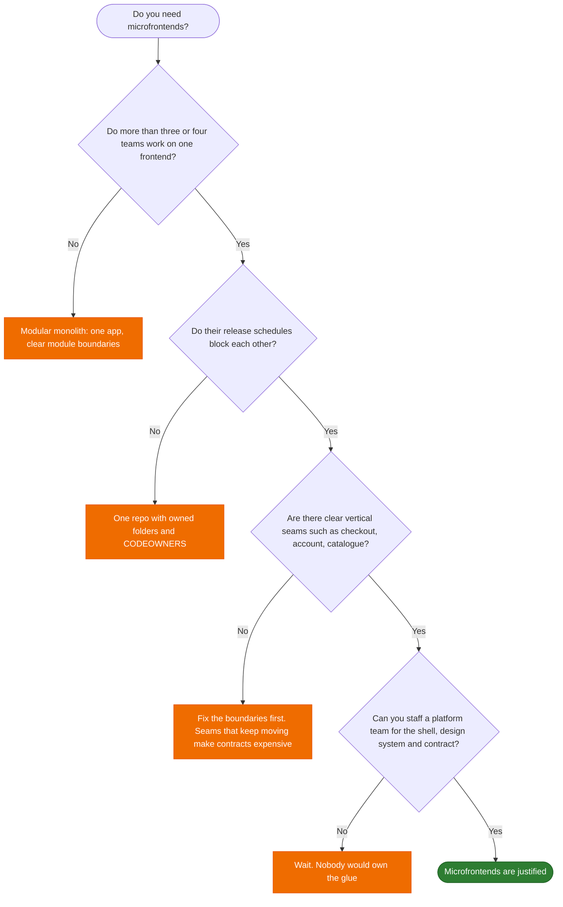
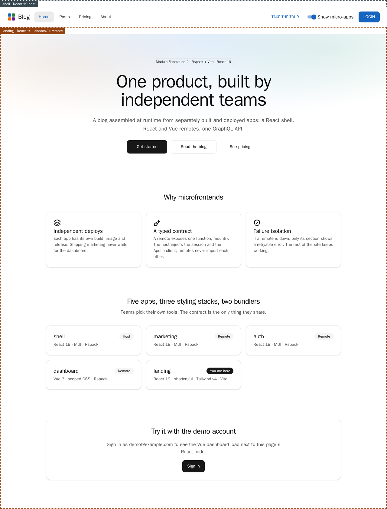
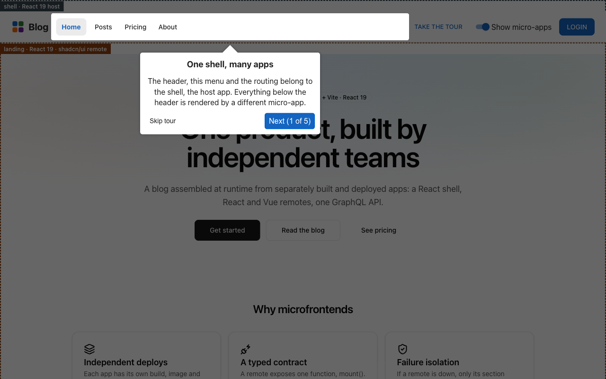
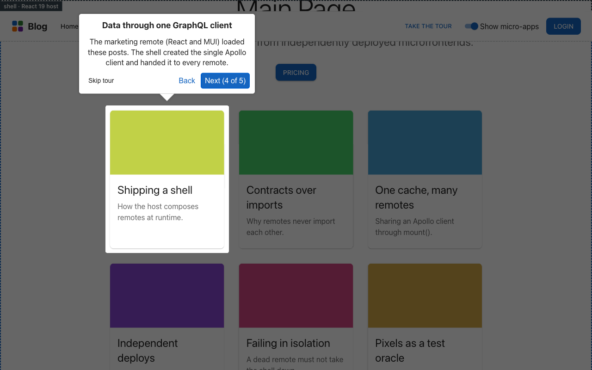

# Do you need microfrontends?

**Short answer:** microfrontends solve an _organisational_ problem, not a technical one. Technically they almost
always make things worse. They are worth it when several teams must ship independently of each other, and not before.

This repo shows _how_ to build them carefully. It does not argue that you should. The shorter, formal version of this
guidance is [ADR 0007](adr/0007-when-not-to-use-microfrontends.md).

## What they give you

| Benefit                   | What it means in practice                                                                   | Where this repo shows it                                                                             |
| ------------------------- | ------------------------------------------------------------------------------------------- | ---------------------------------------------------------------------------------------------------- |
| **Independent releases**  | Team A ships on Tuesday without waiting for Team B's release or asking for a shared freeze. | One image per app ([ADR 0003](adr/0003-same-origin-remote-prefix.md)); only entry files are mutable. |
| **Clear ownership**       | One team owns a slice end to end: UI, data access, tests, deploys, on-call.                 | The ownership overlay names the app that renders every region of the page.                           |
| **Failure isolation**     | A broken section costs you that section, not the whole site.                                | Kill a remote, get a retryable error, the rest keeps working (`e2e/tests/resilience.spec.ts`).       |
| **Incremental migration** | Rewrite or replace a legacy area piece by piece while the product keeps shipping.           | A Vue remote and a Vite-built remote sit beside React/Rspack ones behind one contract.               |
| **Freedom of stack**      | Different teams may pick different tools. Usually a cost you accept, sometimes a necessity. | shadcn/Tailwind, MUI and Vue coexist ([ADR 0010](adr/0010-shadcn-tailwind-remote.md)).               |

The first two are the real reasons. The last one is often sold as a benefit and mostly behaves as a bill.

The release train is cheap and simple until teams start waiting for each other. Independent pipelines remove the
waiting and add everything in the next section.

## What they cost

| Cost                                          | Why it hurts                                                                       | What this repo does about it                                                                 |
| --------------------------------------------- | ---------------------------------------------------------------------------------- | -------------------------------------------------------------------------------------------- |
| **Failures move from build time to run time** | Two apps that compiled fine separately can disagree once they meet in the browser. | A typed `mount()` contract, e2e on the _built_ bundles, an error boundary per remote.        |
| **Duplicated and mismatched dependencies**    | Two copies of React break hooks. Several UI libraries inflate the download.        | Explicit singletons; the host shares `react/jsx-runtime` and `react-dom/client` too.         |
| **Cross-cutting UX**                          | Navigation, session, theme and design language belong to nobody and everybody.     | The host injects the session and one Apollo client; a shared design system.                  |
| **More to deploy and observe**                | Five images, a gateway and cache rules instead of one artefact.                    | One Dockerfile for all apps, nginx gateway, modular CI.                                      |
| **Harder local development**                  | Several dev servers; some tools (HMR across a bundler boundary) do not cross it.   | `pnpm dev` starts everything; the limits are written down in [ADR 0009](adr/0009-rspack.md). |

The deepest cost is the first one:

A whole class of bugs exists only because the pieces are assembled at run time. While building this repo the tests
found four of them: a remote that remounted on every navigation, one remote's error leaking into the next, a failed
remote that could never be retried, and a second copy of React in a remote built with a different bundler. The first
three are in [the bug table in the architecture doc](architecture.md#bugs-this-pyramid-caught-while-building-it);
the last one is in [ADR 0009](adr/0009-rspack.md).

## A decision guide

Warning signs that you are asking the wrong question:

- "The codebase feels big." That is a modularity problem. Fix it with module boundaries, not with deployment.
- "We want to try a new framework." A new framework in one route does not need a separate deploy pipeline.
- "It worked for a company with hundreds of engineers." Their problem was coordination at that scale, not yours.

## What this demo shows

The home page is a remote built with a different stack and a different bundler from the shell around it. Every region
is outlined and named after the app that renders it, so you can see the seams.

  

A first visit opens a five-step guided tour across three micro-apps ([ADR 0011](adr/0011-guided-tour-in-the-shell.md)):

<table>
  <tr>
    <td></td>
    <td></td>
  </tr>
  <tr>
    <td align="center">1. The shell owns the header, the menu and the routing.</td>
    <td align="center">4. The marketing remote renders posts fetched through the one Apollo client the shell hands out.</td>
  </tr>
</table>

What it demonstrates: how to keep the integration surface to one typed function, how to contain failures, how to test
the seams, and how to release the pieces separately. What it does **not** demonstrate: that you should. For a single
team, every one of those techniques is overhead.

## Rule of thumb

> Split the deployment only when the cost of coordinating people is higher than the cost of coordinating software.

If you are not sure, you are not there yet. A modular monolith can be split later along the same seams, and splitting
late is much cheaper than merging back.
